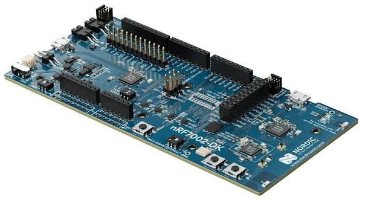
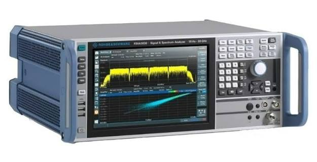
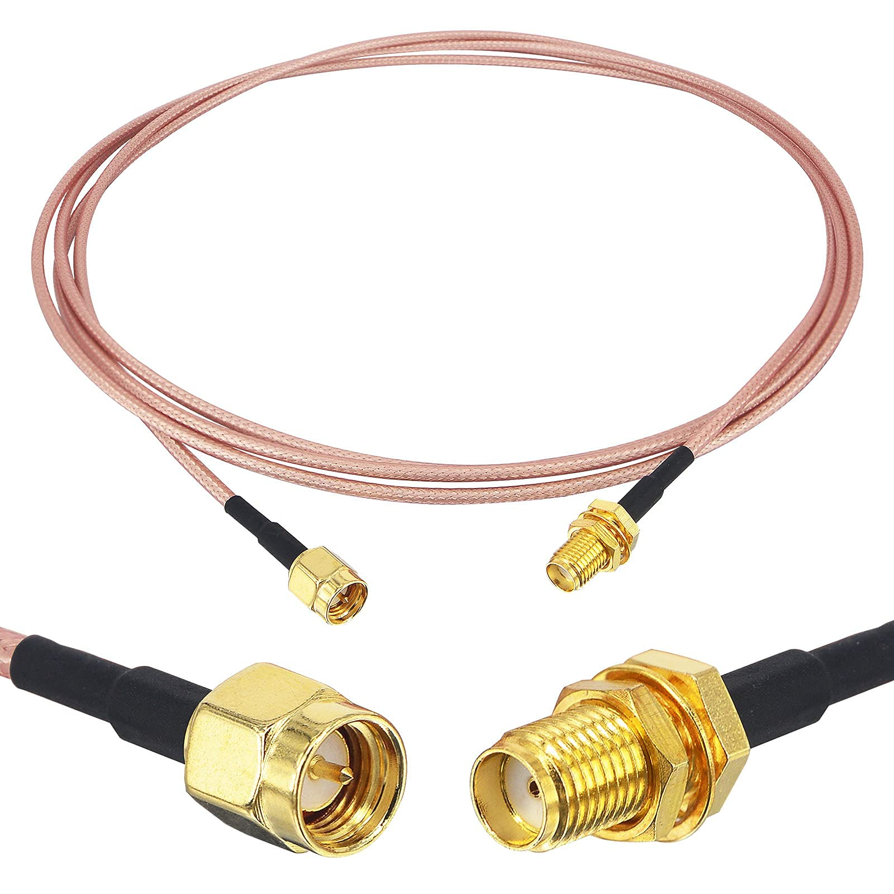
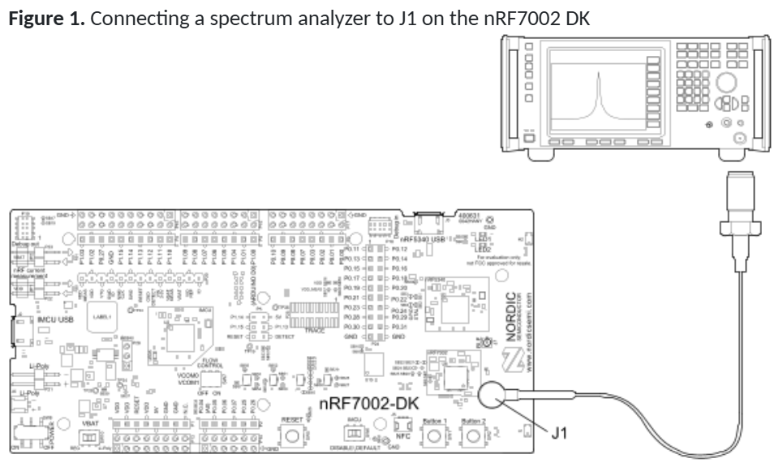
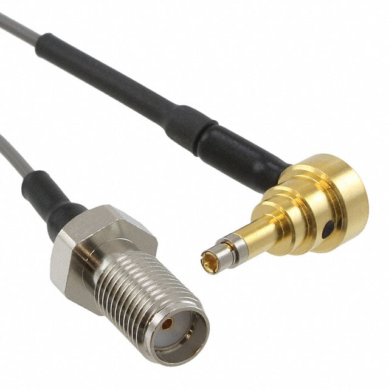

# Labo 1: RED

> Items marked **(confirm)** are typical values or assumptions. Check them against the lab handout, the instructor and the standard before relying on them.

## Preparation

### Goal of the lab
Measure three parameters of a Wi-Fi radio transmitter and judge them against the limits of the harmonised standards:
1. Occupied channel bandwidth
2. RF output power (e.i.r.p.)
3. Unwanted emissions (out-of-band and spurious)

### Regulatory chain
1. Directive 2014/53/EU
   Art. 3.2: efficient use of spectrum
2. Harmonised standard
   ETSI EN 300 328 (2.4 GHz wideband)
   ETSI EN 301 893 (5 GHz RLAN)
3. Test parameters
   What we measure today

### Terminology & abbreviations
**spurious emission**
: unwanted radio frequency (RF) signals transmitted outside a device's necessary bandwidth that can be reduced or removed without affecting the transmitted information

**e.i.r.p.**
: Effective Isotropic Radiated Power. The power a theoretical isotropic antenna would need to radiate to match the signal strength of a real antenna in its strongest direction.

**OBW**
: Occupied bandwidth. The bandwidth that contains 99% of the total transmitted power.

**RBW / VBW**
: Resolution / video bandwidth of the analyser. RBW sets the filter width, VBW smooths the displayed trace.

**dBm**
: $10 \log_{10}{\frac{P}{1mW}}$

**Isotropic Radiator**
: A theoretical point source that radiates energy equally in all directions. It serves as the standard mathematical reference for calculating antenna gain.

**dBi (Decibels relative to Isotropic)**
: A logarithmic unit of measurement used to express the forward gain of an antenna compared to the theoretical baseline of an isotropic radiator (0 dBi).

### Equipment
- DUT
  : Nordic nRF development board with Wi-Fi radio (e.g. nRF7002 DK: 802.11ax, 2.4 and 5 GHz)  
  
- Spectrum analyser  
  
: FSVA3044
- SMA cable  
  
- 20 dB attenuator (SMA), always in line at the analyser input
- USB cable and PC (powers the DUT and gives a serial shell to control the test firmware)

### Measurements
- Conducted measurement via the on-board RF test connector, antenna disconnected  
  
- Provided coaxial connector  
  
- Firmware puts the radio in a fixed-channel test mode
- The connector and test probe add loss to the RF signal, which should be taken into account when measuring.

| Frequency (MHz) | Loss (dB) |
| ----------- | ----------- |
| 2440 | 1.0 |
| 4880 | 1.7 |
| 7320 | 2.6 |

1. Occupied channel bandwidth
   - Bandwidth containing 99% of the transmitted power
   - Must stay inside the allocated band
   - Analyser OBW function, RBW $\approx$ 1-5% of OBW
2. RF output power
   - Mean power during burst
   - Account for duty cycle and attenuator loss
   - Add antenna gain to get e.i.r.p.
3. Unwanted emissions
   - Out-of-band domain next to the band
   - Spurious domain: harmonics and LO products
   - Compare against the masks of the standard

**Check the analyser input before connecting the DUT. Always start with a 20 dB attenuator.**

## Before you start: things to know and bring

- Which test mode and firmware commands start and stop the transmitter (channel, modulation/rate, TX power, packet length, continuous or burst) **(confirm in handout)**
- Which channels to test (see the channel table below)
- Loss of the SMA cable and the attenuator at 2440, 4880 and 7320 MHz **(ask instructor, or measure)**
- Antenna gain to assume for e.i.r.p. **(confirm)**
- Whether a 5 GHz channel is part of the lab, and the losses at those frequencies **(confirm)**
- A calculator, and a results table ready (templates at the end)

### 2.4 GHz channel table (centre frequencies)
| Channel | Centre (MHz) | Remark |
| --- | --- | --- |
| 1 | 2412 | lowest channel, check lower band edge |
| 6 | 2437 | mid-band |
| 11 | 2462 | |
| 13 | 2472 | highest channel in Europe, check upper band edge |

The 2.4 GHz ISM band runs from 2400 to 2483.5 MHz.

## Setup and powering

### Signal chain
DUT test connector → test probe → SMA cable → **20 dB attenuator** → analyser RF input (FSVA3044)

### Powering the DUT
The nRF7002 DK is normally powered over USB from the PC. The same connection usually provides the serial (UART) shell for the test commands **(confirm port and power switch in handout)**.

### Order of operations
1. Switch on the analyser and let it warm up. Run self-alignment if necessary.
2. Preset the analyser.
3. Connect probe, cable and **20 dB attenuator**, and connect to the analyser input.
4. Set reference level offset, frequency, span, RBW, detector.
5. Only then start the transmitter from the shell.
6. When finished, stop TX **before** disconnecting anything.

### Safety for the instruments
- Keep the 20 dB attenuator in line for the whole lab. A Wi-Fi radio can output about +20 dBm, and the analyser input has a maximum level (check the manual) and must never see DC.
- Handle the miniature RF test connector gently. It has a limited number of mating cycles.
- Don't bend the SMA cable sharply, and tighten SMA connectors finger-tight only (or with the torque wrench if provided).
- Remember that connecting the probe bypasses the antenna, so you measure conducted power, not radiated.

### Compensating for losses
- Total loss = connector/probe loss (table above) + SMA cable loss + attenuator loss.
- Enter the total as the **Reference Level Offset** on the analyser, so the display shows the level at the DUT output.
- **Losses are added**: DUT level = displayed level + total loss. A common mistake is subtracting them.
- The loss is frequency dependent. Update the offset when you move to 4880 MHz and 7320 MHz.

Worked example (assumed values: cable 0.5 dB, attenuator 20.0 dB):

| Frequency (MHz) | Probe/connector (dB) | Cable (dB) | Attenuator (dB) | Total offset (dB) |
| --- | --- | --- | --- | --- |
| 2440 | 1.0 | 0.5 | 20.0 | 21.5 |
| 4880 | 1.7 | | | |
| 7320 | 2.6 | | | |

Fill in the real cable and attenuator values from the instructor.

## Measurement 1: occupied channel bandwidth

**Purpose:** find the 99% bandwidth and check that it stays within the band.

**Typical analyser settings (confirm in handout):**
| Setting | Value |
| --- | --- |
| Centre frequency | test channel (e.g. 2437 MHz) |
| Span | 2 to 3 times the expected OBW (about 40-60 MHz) |
| RBW | about 1-5% of OBW (roughly 100-300 kHz) |
| VBW | at least 3 times RBW |
| Detector | peak first, then quasi peak or average |
| Trace | Max Hold or average, wait until stable |
| Function | OBW, 99% |
| Ref level offset | total loss at 2440 MHz |

**Steps**
1. Start TX on the chosen channel with continuous transmission.
2. Set the reference level so the peak is near the top of the screen without an overload warning.
3. Wait for the trace to stabilise, then read the OBW value.
4. Note the lower and upper frequencies (f_L and f_H) of the 99% bandwidth.
5. Repeat on the lowest and highest channel to check the band edges (f_L ≥ 2400 MHz and f_H ≤ 2483.5 MHz).

**What to look out for**
- Signal must be well above the noise floor, otherwise the OBW is overestimated.
- Too wide an RBW or too short a sweep gives a distorted result.
- The mode (802.11b/g/n/ax) and channel width change the result.

**Expected result:** for an OFDM signal in a 20 MHz channel, a 99% OBW of about 16-19 MHz **(confirm)**. DSSS (802.11b) is somewhat narrower. A much wider value points to a settings problem or a different bandwidth mode.

## Measurement 2: RF output power and e.i.r.p.

**Purpose:** verify that the output power stays below the limit.

**Settings**
- Channel power measurement over the occupied bandwidth (or the bandwidth in the handout)
- RMS detector, averaging over enough sweeps
- Ref level offset = total loss at 2440 MHz

**Steps**
1. Measure the conducted power with the transmitter running.
2. Correct for duty cycle if the radio is not transmitting continuously:
   P_avg = P_burst + 10·log₁₀(duty cycle) (the average is lower than the burst power)
   Equivalent: P_burst = P_avg + 10·log₁₀(1/duty cycle).
   The standard specifies which one applies, so check the handout.
3. Add antenna gain: **e.i.r.p. (dBm) = conducted power (dBm) + antenna gain (dBi)**
4. Compare with the limit and compute the margin: margin = limit − e.i.r.p.

**Limits (EN 300 328 / EN 301 893) (confirm)**
- 2.4 GHz: **20 dBm e.i.r.p.** (100 mW). Wideband modulation also has a power spectral density limit of **10 dBm/MHz e.i.r.p.**
- 5 GHz: depends on the sub-band (for example 23 dBm in 5150-5350 MHz). Some sub-bands require DFS and/or TPC, or are indoor only.

**Quick conversions**
- dBm → mW: P(mW) = 10^(P(dBm)/10). Example: 20 dBm = 100 mW.
- 3 dB ≈ factor 2 in power. 10 dB = factor 10.

**What to look out for**
- Overload of the analyser (check for an overload message and the reference level).
- The offset applied twice, or not at all.
- Different power for different data rates or modulations.

**Expected result:** conducted power close to the datasheet value for the chosen settings. Report the raw reading, correction, conducted power, e.i.r.p., limit and margin.

## Measurement 3: unwanted emissions

**Purpose:** show that no significant energy is emitted outside the band.

**Domains**
- **Out-of-band (OOB):** just next to the band edges, compared against the spectrum mask in the standard.
- **Spurious:** the rest of the spectrum, for example 30 MHz up to 12.75 GHz for a 2.4 GHz device **(confirm)**.
  -  Harmonics: 4.8 GHz, 7.2 GHz, 9.6 GHz, 12 GHz, ...
  -  Local oscillator (LO):  $m \cdot f_{\text{LO}} \pm n \cdot f_{\text{RF}}$ with m and n integers

**Typical spurious limits in TX mode (EN 300 328) (confirm in standard/handout)**
| Range | Limit | Measurement bandwidth |
| --- | --- | --- |
| 30 MHz - 1 GHz | −36 dBm | 100 kHz |
| 1 GHz - 12.75 GHz | −30 dBm | 1 MHz |

**Settings**
- Detector and RBW as specified by the limit definition
- Max Hold, with enough sweep time to catch bursts
- Measure in segments (for example around the band edges, then 4880 MHz, then 7320 MHz) rather than one huge sweep
- Update the Reference Level Offset per segment (1.7 dB probe/connector loss at 4880 MHz, 2.6 dB at 7320 MHz, plus cable and attenuator)

**Steps**
1. Check the OOB regions next to the band edges.
2. Look at the 2nd harmonic (about 4880 MHz) and the 3rd harmonic (about 7320 MHz).
3. Sweep the remaining spurious domain and note the highest peak.
4. For each peak: add the losses, add antenna gain if needed (e.i.r.p.), compare with the limit.

**What to look out for**
- **Don't count the carrier** as a spurious emission. Exclude the in-band portion.
- **Analyser-generated harmonics:** a strong carrier can create fake harmonics in the analyser's input mixer.
  - Test: add 10 dB more attenuation. A real DUT spur drops by 10 dB on the display. An analyser-generated 2nd harmonic drops by about 20 dB, and a 3rd harmonic by about 30 dB.
- The noise floor must be well below the limit. More attenuation raises the noise floor relative to the signal.
- Wait for Max Hold to build up.

**Expected result:** harmonics and other spurs comfortably below the limits, with the out-of-band skirts below the mask. Report the worst case in each range with its margin.

## Interpreting and reporting results

For each measurement give: settings, raw reading, corrections, final value, limit, margin, pass/fail.

Discuss the error sources:
- cable and attenuator tolerance
- analyser amplitude accuracy
- mismatch (VSWR) at connectors
- duty cycle and antenna gain assumptions
- conducted versus radiated: a real compliance test of e.i.r.p. includes the antenna
- measurement uncertainty: a small margin to the limit is not a convincing pass

Link the results to RED Art. 3.2: limits on bandwidth, power and spurious emissions protect other spectrum users from interference.

## Quick checklist

**Before the lab**
- Read the handout, know the commands and the channels
- Know the limits (20 dBm e.i.r.p., 10 dBm/MHz, −36 dBm and −30 dBm spurious)
- Have the loss table and the formulas ready
- Bring the results templates

**At the bench**
- 20 dB attenuator in line first, then cable, then DUT, TX on last
- Offset, detector, RBW, span set before judging any value
- Check the trace has settled
- Run the attenuation test on suspect spurs
- Stop TX before disconnecting

**Common mistakes**
- Subtracting instead of adding the losses
- Forgetting to change the offset per frequency
- Counting the carrier as a spur
- Peak detector instead of RMS
- Not waiting for the trace to settle
- Forgetting the antenna gain in the e.i.r.p.

## Troubleshooting
| Symptom | Likely cause |
| --- | --- |
| No signal on analyser | TX not started, wrong channel/centre frequency, loose connector |
| Level much lower than expected | Offset not applied, wrong attenuator, low USB supply, wrong TX power setting |
| OBW too wide | RBW too large, noise included, wrong bandwidth mode |
| Overload warning | Reference level too low or attenuator missing |
| Harmonic changes strongly with attenuation | Analyser-generated, not a DUT spur |
| Unstable power reading | Bursty transmission, too little averaging |

## Results templates

**Occupied bandwidth**
| Channel | Centre (MHz) | OBW 99% (MHz) | f_L (MHz) | f_H (MHz) | Inside band? |
| --- | --- | --- | --- | --- | --- |
| | | | | | |

**Output power**
| Channel | Raw reading (dBm) | Offset (dB) | Conducted (dBm) | Antenna gain (dBi) | e.i.r.p. (dBm) | Limit (dBm) | Margin (dB) |
| --- | --- | --- | --- | --- | --- | --- | --- |
| | | | | | | | |

**Unwanted emissions**
| Frequency (MHz) | Raw reading (dBm) | Offset (dB) | Corrected (dBm) | RBW | Limit (dBm) | Margin (dB) | Pass/fail |
| --- | --- | --- | --- | --- | --- | --- | --- |
| | | | | | | | |

## Questions for the instructor
- Which firmware, mode (802.11b/g/n/ax) and channels?
- Which antenna gain should we assume?
- What are the losses of the SMA cable and attenuator?
- Is a 5 GHz test included, and what are the losses there?
- Which detector, RBW and sweep time does the handout prescribe?

## Sources
1. [Nordic semiconductors](https://docs.nordicsemi.com/r/bundle/ug_nrf7002_dk/page/ug/nrf7002_dk/hw_rf_measure.html)
2. ETSI EN 300 328 and ETSI EN 301 893 (limits and test methods)
3. Directive 2014/53/EU, Art. 3.2